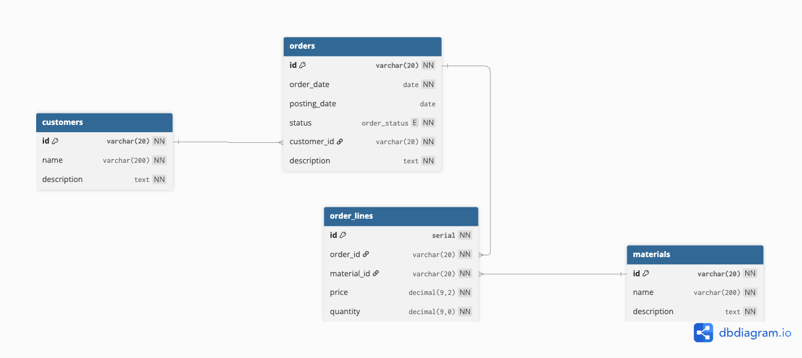

<div align="center">
  
  <h1>Annette Data Dictionary</h1>
  <h3>Единый источник истины для вашей модели данных: описание, генерация кода и документации</h3>
</div>

<p align="center">
  🌍 <a href="README.md">Read in English</a>
</p>

## 🚀 Зачем это нужно?

Устали поддерживать согласованность между SQL-скриптами, кодом приложения и документацией? **Annette Data Dictionary**
решает эту проблему.

**Опишите вашу модель данных один раз на Scala DSL** — и автоматически генерируйте всё необходимое:

* ✅ **SQL DDL-скрипты** (PostgreSQL, ClickHouse)
* ✅ **Код сущностей** (Kotlin, Go для GORM и SQLx)
* ✅ **Техническую документацию** в Excel
* ✅ **Схемы БД** в формате DBML для [dbdiagram.io](https://dbdiagram.io)
* ✅ **Excel-шаблоны** для заполнения и импорта данных

> **Идеально для команд:** однажды определённая модель становится **единым источником истины (Single Source of Truth)**
> для архитекторов, аналитиков и разработчиков.

## Применение в продакшене

Annette Data Dictionary проверен на практике и используется в реальных проектах.  
Например, в микросервисной системе для управления ремонтом оборудования:

- 21 база данных
- более 600 таблиц
- автоматическая генерация кода и документации

Модель данных стала **единым источником истины**, упростив взаимодействие между архитекторами, аналитиками и
разработчиками.

## Оглавление

<!-- TOC -->

* [Начало работы](#начало-работы)
* [Примеры](#примеры)
* [Документация](#документация)

* [Лицензия](#лицензия)

<!-- TOC -->

## Начало работы

Вам потребуется **5-10 минут**, чтобы описать простую модель и сгенерировать из неё артефакты.

### Схема примера

Рассмотрим доменную модель простой системы управления заказами:

- `materials` — справочник материалов
- `customers` — справочник клиентов
- `orders` — заказ клиента (связан с клиентом)
- `order_lines` — позиции заказа (связаны с материалами)

Схема:



### Пошаговая инструкция

**Шаг 1: Добавьте зависимость**

Добавьте Annette Data Dictionary в ваш `build.sbt`:

```sbt
libraryDependencies += "biz.lobachev.annette" %% "data-dictionary-builder" % "0.5.0"
```

**Шаг 2: Опишите модель данных**

Создайте Scala-файл с описанием домена. Вот сокращённый пример:

```scala
import biz.lobachev.annette.data_dictionary.dsl.DSL.*
import biz.lobachev.annette.data_dictionary.labels.Go.*

object OrderDomain {

  val data = domain("Order", "Order model", "Model for simple order management system.",
  )
    .withLabels(
      goTablePackage("github.com/valerylobachev/order/entity"),
      // ...
    )
    .withEnums(
      // ...
    )
    .withDataElements(
      "MaterialId" :! "materialId" :# varchar(20) :@ "Material Id",
      // ...
    )
    .withTables(
      // ...
      table("Order", "Order")
        .withPK(
          "id" :# "OrderId",
        )
        .withFields(
          "orderDate" :# date :@ "Date of order" :== "CURRENT_DATE",
          dataElementTableField("CustomerId"),
          // ...
        )
        .withIndexes(
          index("status", "Index to filter orders by status", "status"),
          // ...
        )
        .withRelations(
          manyToOne("customerId", "Reference to customer", "Customer", "customerId" -> "id")
            .withAssociation("customer", "orders"),
          // ...
        ),
      // ...
    )
    .withStructs(
      // ...
      struct("OrderDto", "Order DTO")
        .likeTable("Order")
        .withFields(
          "totalAmount" :## decimal(9, 2) :@ "Total amount of order",
          "customer" :##? linkedStruct("CustomerDto") :@ "Customer master data",
          "lines" :## linkedStructArray("OrderLineDto") :@ "Order lines",
        ),
      // ...
    )
}
```

*Полный код смотрите
в [примере OrderDomain.scala](src/test/scala/biz/lobachev/annette/data_dictionary/test/order/OrderDomain.scala).*

**Шаг 3: Напишите код генератора**

Создайте главный класс для сборки модели и запуска генераторов.

```scala
object Order extends App {

  val build = DomainBuilder.build(OrderDomain.data)

  build match {
    case Left(messages) =>
      messages.foreach(println)
    case Right(result) =>
      result.warnings.foreach(println)
      val domain = result.domain
      Generator.generate(PostgresDDLGenerator(domain), s"examples/${domain.id}/ddl")
    // ...
  }
}
```

*Полный код смотрите
в [примере Order.scala](src/test/scala/biz/lobachev/annette/data_dictionary/test/order/Order.scala).*

**Шаг 4: Запустите генерацию**

Выполните в командной строке:

```bash
sbt run biz.lobachev.annette.data_dictionary.test.order.Order
```

**Шаг 5: Получите артефакты**

Сгенерированные файлы появятся в папке examples/Order:

    ```
    Order/
    ├── ddl                       - DDL скрипты  
    │   ├── click_house_ddl.sql   - DDL скрипт для ClickHouse 
    │   └── postgres_ddl.sql      - DDL скрипт для PostgreSQL 
    ├── go_gorm                   - Исходный код Go для библиотеки Gorm
    ├── go_sqlx                   - Исходный код Go для библиотеки sqlx
    ├── kotlin                    - Исходный код Kotlin 
    ├── xls_data                  - Excel шаблоны для загрузки данных
    ├── Order.dbml                - Схема модели данных в формате DBML
    ├── go-domain.xlsx            - Описание доменной модели данных (с типами данных Go) в формате Excel
    └── kotlin-domain.xlsx        - Описание доменной модели данных (с типами данных Kotlin) в формате Excel
    ```

## Примеры

Изучите готовые примеры, чтобы лучше понять синтаксис DSL:

| Пример      | Описание                                   | Ссылки                                                                                                                                                                                                                           |
|-------------|--------------------------------------------|----------------------------------------------------------------------------------------------------------------------------------------------------------------------------------------------------------------------------------|
| **Order**   | Простая модель заказов (4 таблицы)         | • [модель](src/test/scala/biz/lobachev/annette/data_dictionary/test/order/OrderDomain.scala) <br>• [код генерации](src/test/scala/biz/lobachev/annette/data_dictionary/test/order/Order.scala) <br>• [артефакты](examples/Order) |
| **Finance** | Сложная модель, похожая на SAP ERP Finance | • [модель](src/test/scala/biz/lobachev/annette/data_dictionary/test/finance/Finance.scala) <br>• [код генерации](src/test/scala/biz/lobachev/annette/data_dictionary/test/FinanceSpec.scala) <br>• [артефакты](examples/Finance) |

## Документация

Подробная документация с полным описанием возможностей DSL и API доступна в [основном руководстве](docs/index_ru.md):

* **[Язык описания модели (DSL)](docs/index_ru.md#язык-описания-модели-dsl)** — полный справочник по синтаксису.
* **[Сборка модели и генерация артефактов](docs/index_ru.md#сборка-модели-и-генерация-артефактов)** — как настроить и
  запустить генерацию.

## Лицензия

Annette Data Dictionary распространяется по лицензии [Apache License 2.0](https://www.apache.org/licenses/LICENSE-2.0).

© 2023 Valery Lobachev. All rights reserved.